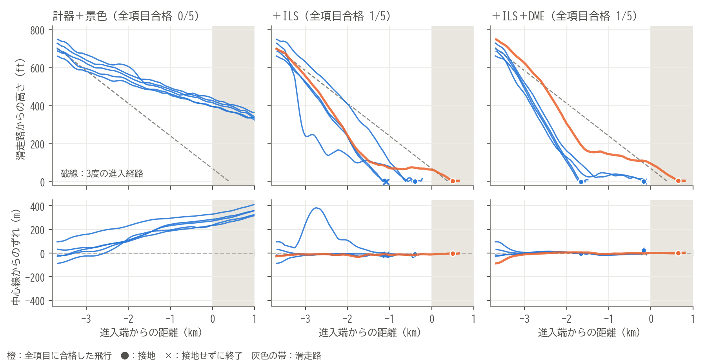

# パイロットと同じ情報で着陸できるか：SmolVLAによる小型機の着陸

Physical AI 応用編1（東京大学 松尾・岩澤研究室）の最終課題のリポジトリです。

フライトシミュレーター **FlightGear** で、セスナ172P（C172P）を **羽田空港（RJTT）の滑走路34R** に着陸させるタスクを、ロボット用の視覚・言語・行動モデル（VLA）**SmolVLA** に追加学習させました。AIに与える情報は、**パイロットが操縦席で使えるもの（計器と窓の外の景色）だけ**に限っています。

- **入力**：窓の部分を切り出した画像（512×512）、指示文（"Land on runway 34R at Haneda and keep the aircraft on the runway."）、計器の値（高度計・速度計・昇降計・姿勢・方位・旋回計・接地、ILSのコースと進入角の針、DMEの距離）
- **出力**：エルロン・エレベーター・ラダー・スロットルの4つの操作
- **学習データ**：自作の自動着陸（お手本）の飛行のうち、全評価項目に合格したもの224回（AIが陥った状態から立て直すDAggerの飛行を含む）

- 提出レポート：[docs/report/説明資料_PAI最終課題_Morita_Junichiro.pdf](docs/report/説明資料_PAI最終課題_Morita_Junichiro.pdf)（原稿は [report.html](docs/report/report.html)）
- 動画：YouTube（提出時に記載）
- 試行錯誤の記録：[docs/report-notes.md](docs/report-notes.md)

## 結果の概要

評価は、学習に使っていない5つの開始位置（乱数の番号1000〜1004）で行いました。

| AIの入力 | お手本 | 全項目に合格 | 様子 |
| --- | --- | --- | --- |
| 学習前 | — | 0/5 | 開始15〜19秒で裏返って海へ |
| 位置の数値（比較用。パイロットは知り得ない） | 48回 | 1/5 | 5回とも接地帯に接地 |
| 計器＋景色 | 78〜224回 | 0〜1/5 | 自分の位置と距離を景色から読めず、ずれを戻せない（DAggerを3回試しても同じ） |
| 計器＋ILS＋景色 | 224回 | 1/5 | 横のずれを戻せるようになった |
| **計器＋ILS＋DME＋景色** | 224回 | **1/5** | 高さのずれも戻し始めた。1001は進入端から646 m、中心線から0.2 mに接地 |



景色だけでは、AIは自分の位置と距離を読み取れませんでした。ILSで横、DMEで縦のずれを戻し始めたことから、足りなかったのは操縦ではなく距離感だったと考えています。感度解析と画像の差し替え試験の結果はレポートの7章にあります。

## 全体の構成

```text
Windows                                          WSL2 Ubuntu
┌────────────────────────┐   UDP 20 Hz   ┌───────────────────────┐
│ FlightGear 2024.1.4    │ ─ 状態 ───▶ │ 収録・操縦プログラム  │
│ （C172P・羽田34R）     │ ◀── 操作 ─ │ landing/session.py    │
│ ゲームパッドF310       │   HTTP 8080   │ （Windows版Python）   │
└────────────────────────┘ ◀─ 画像・一時停止 └──────────┬────────────┘
                                                        │ 共有ディレクトリ
                                             ┌──────────▼────────────┐
                                             │ SmolVLA推論ワーカー   │
                                             │ landing/vla.py serve  │
                                             │ （RTX 3060）          │
                                             └───────────────────────┘
```

- **FlightGear（Windows）**：描画、飛行モデル（JSBSim）、ゲームパッド入力を担当します。機体の状態を毎秒20回UDPで送り、操作をUDPで受け取ります。
- **収録・操縦プログラム（Windows版Python、標準ライブラリのみ）**：状態・画像・操作を記録し、着陸を自動で評価します。お手本の自動着陸や、学習済みのAIもここから操縦します。
- **学習・推論（WSL2 Ubuntu、GPU）**：SmolVLAの追加学習と推論ワーカーを動かします。収録プログラムとは、リポジトリ内の共有ディレクトリでやり取りします。画像の取得とVLAの推論の間はシミュレーションを一時停止するので、動画はコマ送りになります。

## 動作環境

| 用途 | 環境 | 依存関係の管理 |
| --- | --- | --- |
| シミュレーター・収録・操作送信 | Windows 11、FlightGear 2024.1.4、Python 3.12以降（確認は3.13）、FFmpeg | Pythonは標準ライブラリのみ |
| 共通コード・テスト・比較用MLP | WSL2 Ubuntu 22.04、Python 3.12.12、PyTorch 2.11.0+cu128 | ルートの `pyproject.toml` / `uv.lock` |
| SmolVLAの学習・推論 | 同上、LeRobot 0.4.3、PyTorch 2.7.1+cu128 | `environments/vla/pyproject.toml` / `uv.lock` |

- GPU：NVIDIA RTX 3060（12 GB）で確認しました。SmolVLAの追加学習はバッチ8で約5 GBを使います。
- ゲームパッド：Logicool F310（人が操縦する場合のみ）。
- Pythonの環境構築と依存関係の管理には **uv** を使います（確認したのは0.10.12）。

## 環境構築

### 1. Python・GPU環境（Ubuntu）

リポジトリを取得したディレクトリで実行します。

```bash
uv python install 3.12.12
uv sync --locked
uv run --locked python scripts/check_environment.py   # GPUでの学習1ステップとJSBSimの動作確認
uv sync --project environments/vla --locked           # SmolVLA用の専用環境
```

`uv run` を使うため、仮想環境を手動で有効にする必要はありません。SmolVLAは専用の環境で、ルートの `uv sync` だけでは導入されません。

### 2. FlightGear（Windows PowerShell）

```powershell
winget install --id FlightGear.FlightGear --exact --source winget --version 2024.1.4
```

インストール後、スタートメニューからFlightGearを一度起動し、初回画面で基本データ（fgdata）をダウンロードします。C172Pは基本データに含まれています。

### 3. 羽田周辺の風景（Ubuntu）

```bash
uv run --locked python scripts/download_rjtt_scenery.py \
  --destination "/mnt/c/Users/<Windowsユーザー名>/FlightGear/Custom Scenery/physical-ai"
```

羽田を含むタイル（約81 MB）をTerraSyncの配布元から取得し、ハッシュとサイズを検証します。

### 4. 追加の機体（任意、Ubuntu）

旅客機（Boeing 747-400）と戦闘機（F-14B）も、羽田34Rへの進入シナリオを用意しています（収録・学習は未実施）。使う場合のみ取得します。

```bash
uv run --locked python scripts/install_aircraft.py \
  --destination "/mnt/c/Users/<Windowsユーザー名>/FlightGear/Custom Aircraft/physical-ai"
```

取得元とコミットは `config/aircraft-lock.json` に固定しています。F-14にはFlightGear 2024.1で動かすための修正パッチ（`patches/f14-nasal-2024.patch`）を適用します。機体データはこのリポジトリに含めません。

### 5. ゲームパッド（人が操縦する場合のみ、Windows）

F310背面のスイッチを **X**（XInputモード）にしてUSB接続します。FlightGearでの割当は不要で、起動スクリプトが `config/input/f310-landing.xml` を読み込みます。

| F310 | 操作 |
| --- | --- |
| 左スティック | 操縦桿（エルロン・エレベーター） |
| 右スティック左右 | ラダー |
| RT / LT | スロットルを上げる / 下げる（離すとその値を保持） |
| ボタン | 割当なし（フラップ・ブレーキ・トリムの誤操作を防ぐ） |

### 6. FFmpeg（Windows）

動画の保存に使います。`C:\ffmpeg\bin\ffmpeg.exe` に置くか、収録スクリプトに `-FFmpeg <パス>` を指定します。

### 7. 動作確認（Windows PowerShell）

Windows側のコマンドは、すべてリポジトリのディレクトリで実行します。WSL上のリポジトリには `\\wsl.localhost\Ubuntu\home\<ユーザー名>\physical-ai-applied1-2026` でアクセスできます。

```powershell
Set-Location \\wsl.localhost\Ubuntu\home\<ユーザー名>\physical-ai-applied1-2026
powershell -NoProfile -ExecutionPolicy Bypass -File ./scripts/start_flightgear.ps1 -Aircraft c172p
# 別のPowerShellで、地形と飛行モデルの初期化を確認する
powershell -NoProfile -ExecutionPolicy Bypass -File ./scripts/check_flightgear.ps1 -ExpectedAircraft c172p
```

羽田34Rの地上で、一時停止した状態で起動します。確認できたらFlightGearを閉じます。

## 使い方

全体の流れは **お手本の収録 → 確認・採用 → SmolVLAの準備 → 学習前の評価 → 追加学習 → 学習後の評価 → 比較** です。最終モデル（計器＋ILS＋DME＋窓の切り出し）の作り方は、[最終モデルを作る](#最終モデルを作る) にまとめています。

### 1. お手本の飛行を収録する（Windows）

`scripts/fly_c172p.ps1` が、FlightGearの再起動、開始位置の設定、収録、動画の保存までを1コマンドで行います。

```powershell
# 自作の自動着陸（お手本）。番号は学習用の1〜999から、毎回違うものを使う
powershell -NoProfile -ExecutionPolicy Bypass -File ./scripts/fly_c172p.ps1 -Seed 201 -Autoland
# 開始時のずれを広げた条件（wide / wide-half / wide-quarter）
powershell -NoProfile -ExecutionPolicy Bypass -File ./scripts/fly_c172p.ps1 -Seed 301 -Autoland -StartProfile wide-half
# 人がゲームパッドで操縦する場合
powershell -NoProfile -ExecutionPolicy Bypass -File ./scripts/fly_c172p.ps1 -Seed 11
```

- 記録は `datasets/c172p/expert-<番号>`（人の場合は `flight-<番号>`）に保存します。中身は、状態と操作（`samples.jsonl`）、画像（`frames/`）、動画（`flight.mp4`）、条件と評価（`metadata.json`）です。
- 自動着陸は、画像を撮るたびにシミュレーションを止めるため、1回に実時間で2〜6分かかります。
- 接地の5秒後、または墜落・着水したら自動で終了します。終了時に評価結果と、改善点のフィードバックを表示します。

まとめて収録する例：

```powershell
foreach ($s in 202..225) {
    powershell -NoProfile -ExecutionPolicy Bypass -File ./scripts/fly_c172p.ps1 -Seed $s -Autoland
}
```

### 2. 評価を確認し、学習に使う飛行を採用する

```bash
# 全飛行の評価を一覧する（WindowsではUbuntuの python3 の代わりに py -3）
python3 -m landing.session review datasets/c172p
# 全項目に合格し、動画で確認した飛行を採用する
python3 -m landing.session label datasets/c172p/expert-201 --outcome success --note "動画で確認"
```

全項目に合格していない飛行には `success` を付けられません。学習時にも、採用済み・全項目合格・学習用の番号であることなどを再検査します。

### 3. SmolVLAを準備する（Ubuntu）

```bash
uv run --project environments/vla --locked python -m landing.vla prepare \
  --scenario config/scenarios/c172p-rjtt-34r-approach.json --output runs/vla/c172p-base
uv run --project environments/vla --locked python -m landing.vla check \
  --model runs/vla/c172p-base --backward   # 模擬入力で推論・逆伝播を確認
```

事前学習済みの `lerobot/smolvla_base` を、航空機の状態17個・操作4つに付け替えたモデルを作ります。版は `config/vla-model-lock.json` に固定しています。

`--features instruments` を付けると、状態の入力を、パイロットが計器で読める9個（高度計の高さ、対気速度、降下率、バンク、ピッチ、方位のずれ、旋回の速さ、接地）に限ったモデルを作ります。滑走路までの距離や横ずれ、対地高度、対地速度は入力せず、画像から読ませます。収録データは17個のまま記録し、モデルが使う値だけを選んで入力します。

```bash
uv run --project environments/vla --locked python -m landing.vla prepare --features instruments \
  --scenario config/scenarios/c172p-rjtt-34r-approach.json --output runs/vla/c172p-base-instruments
```

### 4. 学習前のモデルで飛ばす（評価）

Ubuntuで推論ワーカーを起動し、`VLA worker ready` が表示されるのを待ちます。

```bash
uv run --project environments/vla --locked python -m landing.vla serve \
  --model runs/vla/c172p-base --bridge runs/vla/bridge-base --seed 42
```

Windowsで、評価用の番号（1000以上）から飛ばします。結果は `runs/eval/<ブリッジ名>-<番号>` に保存されます。

```powershell
foreach ($s in 1000..1004) {
    powershell -NoProfile -ExecutionPolicy Bypass -File ./scripts/fly_c172p.ps1 -Seed $s -VlaBridge runs/vla/bridge-base
}
```

ワーカーは、Ubuntu側で `Ctrl+C` を押して止めます。ワーカーを起動し直すときは、新しいブリッジのディレクトリを指定します。

### 5. 追加学習する（Ubuntu）

採用した飛行だけを渡します。RTX 3060で15000ステップに約1時間かかります。

```bash
# 今のシナリオ（タスク条件）で採用済みの飛行だけを選ぶ
EPISODES=$(python3 -m landing.session approved datasets/c172p \
  --scenario config/scenarios/c172p-rjtt-34r-approach.json)
uv run --project environments/vla --locked python -m landing.vla train $EPISODES \
  --base runs/vla/c172p-base --output runs/vla/c172p-finetuned \
  --steps 15000 --batch-size 8 --device cuda --seed 42
```

飛行単位で学習用8割・検証用2割に分けます。機体の状態は、学習用データの平均と標準偏差で正規化し、その値をモデルと一緒に保存します。

### 6. 学習後のモデルで飛ばし、比較する

4と同じ手順で、学習後のモデルのワーカー（`--model runs/vla/c172p-finetuned --bridge runs/vla/bridge-finetuned`）を起動し、同じ番号1000〜1004で飛ばします。そのあと、Ubuntuで比較します。

```bash
python3 -m landing.compare \
  --before runs/eval/bridge-base-100? --after runs/eval/bridge-finetuned-100? \
  --output runs/compare/base-vs-finetuned.json
```

比較では、前後が同じ評価用の番号の組であること、同じ条件であることを確認します。失敗や中断した飛行も含めて、全項目の合格率、接地できた割合、項目ごとの合格数を集計します。

### 7. AIが何に反応しているかを調べる（感度解析）

評価で飛んだ記録の画像と状態をモデルに入れ直し、状態を1つずつ±0.1標準偏差ずらしたときの操作の変化（中心差分）と、画像だけ・状態だけを別の場面のものに差し替えたときの変化を求めます。FlightGearは使いません（GPUで約25分）。手法は2002年のパイロットモデルの研究（doi:10.1299/jsmetld.2002.11.373）にならっています。

```bash
uv run --project environments/vla --locked python scripts/analyze_sensitivity.py \
  --model runs/vla/c172p-expert-wide-norm-15000 \
  --output runs/analysis/sensitivity.json runs/eval/vla-expert-wide-norm-15000-100?
```

### 8. 比較用：数値の状態だけを使うMLP（任意）

画像を使わない小さなニューラルネットでも、同じデータで模倣学習できます。

```bash
uv run --locked python -m landing.train $EPISODES --output runs/mlp/c172p-expert
```

```powershell
powershell -NoProfile -ExecutionPolicy Bypass -File ./scripts/fly_c172p.ps1 -Seed 1000 -Policy runs/mlp/c172p-expert/policy.json
```

FlightGearを使わず、WSL上のJSBSim（FlightGearのC172Pの飛行モデル）で自動着陸やMLPを高速に試すこともできます。地形は平らで、機体側のスクリプトは近似です。最終的な評価はFlightGearで行います。

```bash
uv run --locked python scripts/offline_autoland.py \
  --fgdata "/mnt/c/Users/<Windowsユーザー名>/FlightGear/Downloads/fgdata_2024_1" --seeds 1000 1001 1002 \
  [--policy runs/mlp/c172p-expert/policy.json]
```

## 最終モデルを作る

### 1. 近くからのお手本とDAgger（Windows・Ubuntu）

```powershell
# 滑走路の近くから、大きくずれた状態で始めるお手本
powershell -NoProfile -ExecutionPolicy Bypass -File ./scripts/fly_c172p.ps1 -Seed 401 -Autoland -StartProfile near-1500
# DAgger：学習したAIを学習用の番号で飛ばす（runs/rollouts/ に保存。評価用の番号は使えない）
powershell -NoProfile -ExecutionPolicy Bypass -File ./scripts/fly_c172p.ps1 -Seed 511 -VlaBridge runs/vla/<ブリッジ名> -Rollout
```

```bash
# AIが経路から外れた状態を開始状態として抜き出す（--mirror で中心線と進入経路に対して反転、--only-high で高すぎの状態だけ）
python3 scripts/dagger_starts.py runs/rollouts/<ロールアウト>-51? --only-high --max-height-error-ft 450 \
  --distances 3300 3000 2700 2400 2100 --first-seed 701 --output config/dagger/c172p-r2-high.json
```

抜き出した状態から、お手本を `-Autoland -StartProfile dagger-r2-high -Seed 701` のように収録します。開始状態の機首の角度（ピッチ）も再現します。

### 2. 計器＋ILS＋DMEのモデルを学習する（Ubuntu）

```bash
uv run --project environments/vla --locked python -m landing.vla prepare --features instruments-ils-dme \
  --window --image-size 512 \
  --scenario config/scenarios/c172p-rjtt-34r-approach.json --output runs/vla/c172p-base-instruments-ils-dme-window
EPISODES=$(python3 -m landing.session approved datasets/c172p \
  --scenario config/scenarios/c172p-rjtt-34r-approach.json)
uv run --project environments/vla --locked python -m landing.vla train $EPISODES \
  --base runs/vla/c172p-base-instruments-ils-dme-window --output runs/vla/c172p-instruments-ils-dme-window-15000 \
  --steps 15000 --batch-size 8 --device cuda --seed 42
```

- `--features`：`all`（位置の数値17個）、`instruments`（計器9個）、`instruments-ils`（＋ILSの針2個）、`instruments-ils-dme`（＋DME）。
- ILSの針とDMEの値は、記録した位置から計器と同じ定義で計算します（コースは±2.5°、進入角は±0.7°で振り切れ、100 ft未満では進入角の針を0。DMEは0.1 NM刻み）。お手本を取り直す必要はありません。
- `--window`：操縦席の画像から窓の部分を正方形に切り出します。`--vision-layers N` で画像を読む部分の最後のN層も学習し、`--weight-profile 開始条件=倍率` で特定の開始条件のお手本を多めに使います。
- RTX 3060で約3時間かかります。評価は「使い方」の4と同じ手順で行います。

## タスクと評価

設定は `config/scenarios/c172p-rjtt-34r-approach.json` にあります。

| 項目 | 内容 |
| --- | --- |
| 開始 | 34Rの進入端から2 NM（3704 m）手前、滑走路面から706 ft、70 kt。昼間・無風 |
| 接地目標 | 進入端から400 m（ICAOのエイミングポイント）。この点に向かう3度の経路を進入の目安にする |
| 開始位置のずれ | 乱数で横±100 m・高さ±60 ft・機首方位±5度・速度±5 kt |
| 操作 | エルロン・エレベーター・ラダー・スロットル |
| 固定する設定 | フラップ10度、脚、トリム0、ブレーキ0 |
| 終了 | 接地の5秒後。墜落・着水、または接地しないまま300秒（シミュレーション時間）で終了 |

開始位置のずれは、乱数の番号（`-Seed`）で決まります。

| 番号 | 用途 |
| --- | --- |
| 0 | ずれなしの基準位置（動作確認用） |
| 1〜999 | 学習データの収録 |
| 1000以上 | 評価専用。学習データには使えない |

お手本の収録では、開始時のずれを広げた条件（`-StartProfile`）も使えます。経路から大きくずれた状態から戻す手本を集めるためで、評価は標準の条件だけで行います。

| 条件 | 開始距離 | ずれ（高さ・横） |
| --- | --- | --- |
| `wide` | 2 NM | ±150 ft・±150 m |
| `wide-half` | 1/2 | ±75 ft・±75 m |
| `wide-quarter` | 1/4 | ±37 ft・±37 m |
| `near-2500` 〜 `near-600` | 2.5〜0.6 km手前 | 縮めずに±30〜±80 ft・±50〜±150 m |
| `dagger-r1`・`dagger-r1-mirror`・`dagger-r2-high` | 記録した状態 | AIが陥った状態（`config/dagger/`） |

着陸は次の項目で評価し、すべて合格したものを成功とします。

| 項目 | 判定 |
| --- | --- |
| 墜落なし | FlightGearが墜落と判定しない |
| 接地位置 | 進入端から0〜900 m |
| 中心線 | 接地時の横ずれ15 m以内 |
| 降下率 | 接地直前の降下速度が−0.5〜10 ft/s |
| バンク角 | 接地時の傾き8度以内 |
| 主脚からの接地 | 接地時のピッチ0度以上 |
| 機首方位 | 滑走路の向きとのずれ5度以内 |
| バウンドなし | 接地後に再び浮いた高さ2 ft以内 |
| 滑走路内の滑走・規定時間の滑走 | 滑走路から出ずに5秒滑走する |
| 損傷なし | 脚が折れていない |

C172Pは、空中で開始した5秒後に、機体側のスクリプトがフラップとスロットルを書き換えます。収録プログラムはこれを検知して元に戻し、その時点の記録は学習に使いません。

## コード構成

| パス | 役割 |
| --- | --- |
| `landing/core.py` | 状態・操作の定義、開始位置の生成、進入経路の計算、着陸の評価 |
| `landing/session.py` | 収録、AIの操縦、評価の一覧・ラベル付け（Windows版Pythonで動く） |
| `landing/autoland.py` | 自作の自動着陸（お手本） |
| `landing/feedback.py` | 飛行後の振り返りと改善点の表示 |
| `landing/vision.py` | 画像の取得と、推論ワーカーとの通信 |
| `landing/data.py` | 学習データの検査と、画像・状態・操作の対応付け |
| `landing/vla.py` | SmolVLAの準備・追加学習・推論ワーカー |
| `landing/train.py` | 比較用MLPの学習 |
| `landing/compare.py` | 学習前後の比較 |
| `scripts/fly_c172p.ps1` | 起動から収録・評価飛行までを1コマンドで行う |
| `scripts/start_flightgear.ps1` | シナリオと開始位置を指定してFlightGearを起動する |
| `scripts/offline_autoland.py` | JSBSimでの高速な試行 |
| `scripts/analyze_sensitivity.py` | 学習後のモデルの感度解析（入力ごとの反応、画像と状態の効き） |
| `scripts/dagger_starts.py` | DAgger：AIのロールアウトから開始状態を抜き出す |
| `config/dagger/` | DAggerの開始状態（一度作ったら変更しない） |
| `config/scenarios/` | 機種ごとのシナリオ（開始条件・評価基準） |
| `config/protocols/` | FlightGearとのUDP通信の定義 |
| `tests/` | 模擬データによる回帰テスト |

収録した飛行・モデル・動画（`datasets/`、`runs/`）はGitに含めません。

## テスト

```bash
uv run --locked ruff check . && uv run --locked ruff format --check .
uv run --locked python -m unittest discover -s tests -v
```

模擬データと模擬通信による40件のテストで、評価、収録の異常処理、データの検査、学習データの対応付けなどを確認します。

## レポートの図とPDFの作成

図3（計器を加えるごとの飛行経路）と、レポートのPDFは次のコマンドで作り直せます。レポートの原稿は `docs/report/report.html`（1ページずつ組んだA4のHTML）で、WindowsのChromeでPDFに印刷します。

```bash
uv run --with matplotlib==3.10.3 python scripts/plot_input_ladder.py \
  --group "計器＋景色" runs/eval/vla-instruments-window-dagger3-15000-r2-100? \
  --group "＋ILS" runs/eval/vla-instruments-ils-window-15000-100? \
  --group "＋ILS＋DME" runs/eval/vla-instruments-ils-dme-window-15000-100? \
  --font /mnt/c/Windows/Fonts/BIZ-UDGothicR.ttc --output docs/report/figures/fig5-input-ladder.png
python3 scripts/build_report.py \
  --chrome "/mnt/c/Program Files/Google/Chrome/Application/chrome.exe" [--youtube <動画のURL>]
```

## 提出動画の作成

収録した飛行から、提出用の動画（約2分15秒、1280×720）を作ります。AIの計算中や画像の撮影中はシミュレーターを一時停止しているため、録画には止まっている時間が含まれます。各コマを飛行データのシミュレーション時刻に対応づけて並べ直し、その時間をカットします（動画内に明記）。BGMは1回だけ流し、曲が終わったあとの結論の画面は無音です。最初と最後には、講座が配布したオープニングとエンディング（各約3秒、任意）を入れます。講座の素材はリポジトリに含めていません（`--opening`・`--closing` を省けば、なしで作れます）。

```bash
uv run --with pillow==12.0.0 python scripts/make_video.py \
  --before runs/eval/vla-instruments-window-dagger3-15000-r2-1001 \
  --after runs/eval/vla-instruments-ils-dme-window-15000-1001 \
  --expert datasets/c172p/expert-201 --font /mnt/c/Windows/Fonts/BIZ-UDGothicB.ttc \
  --music "runs/video/music/Mistake the Getaway.mp3" \
  --opening materials/lectures/final-project/PAI応用1_最終課題_OP.mp4 \
  --closing materials/lectures/final-project/PAI応用1_最終課題_ED.mp4 \
  --output runs/video/PAI最終課題_143108.mp4
```

BGMは Kevin MacLeod「Mistake the Getaway」（[incompetech.com](https://incompetech.com/)、CC BY 4.0）です。音源はリポジトリに含めていないため、同サイトから入手して `runs/video/music/` に置いてください。

## ドキュメント

| 文書 | 内容 |
| --- | --- |
| [レポート](docs/report/report.html) | 提出用レポートの原稿（HTML）。PDFは `docs/report/説明資料_PAI最終課題_Morita_Junichiro.pdf` |
| [試行錯誤の記録](docs/report-notes.md) | 問題・原因・対策・結果の記録 |
| [プロジェクト方針](docs/project-plan.md) | 決定事項と経緯（日付つき） |
| [VLAパイプライン](docs/vla-pipeline.md) | SmolVLAの手順とデータの条件の詳細 |
| [着陸パイプライン](docs/landing-pipeline.md) | 収録・評価・MLPの手順の詳細 |
| [環境構築メモ](docs/environment-setup.md) | 環境構築の確認状況と参考資料 |
| [シミュレーターの導入確認](docs/simulator-validation.md) | 3機種の導入確認と既知の問題 |
| [機体選定](docs/aircraft-selection.md) | 機体の選定理由と制約 |
| [最終課題の要件](docs/final-project-requirements.md) | 課題の要件と提出チェックリスト |

## ライセンス

このリポジトリのコードと文書は [MIT License](LICENSE) で公開します。FlightGear本体、機体データ、風景データ、SmolVLAの重み、講座の資料は含めていません。それぞれの配布元のライセンスに従って取得してください（SmolVLA・LeRobotはApache-2.0）。

## 講座・課題

- [講座情報（東京大学 松尾・岩澤研究室）](https://weblab.t.u-tokyo.ac.jp/lecture/course-list/physical-ai/advanced1/)
- 最終課題の要件は、講座の案内（10/19版）に基づいています。
- 講座の資料（原本と、その要点のメモ）は、開示制限に基づきGitの管理対象外としています。
